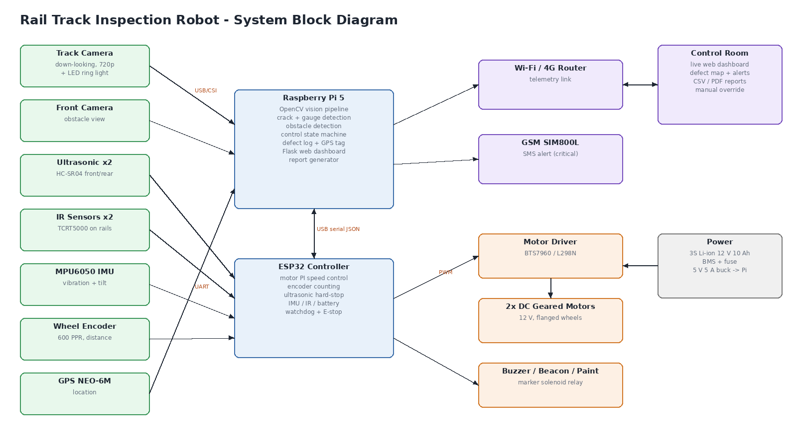
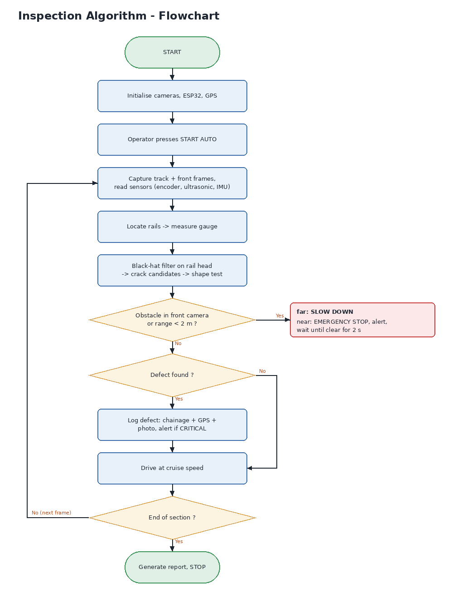

# Autonomous Rail Track Inspection Robot: Project Report

## 1. Abstract

Track defects such as rail cracks, gauge widening and obstructions on the line are a major cause of derailments. In India, track inspection is still largely manual. Trackmen and keymen walk or push a trolley along the line and inspect a few kilometres at a time by eye. This is slow, tiring and depends on the inspector's skill, and small cracks are easy to miss.

This project presents a **low-cost autonomous rail-mounted inspection robot**. It drives along the track by itself and uses a down-looking camera to detect **rail-head cracks** and measure **track gauge** with computer vision (OpenCV). A front camera together with ultrasonic sensors detects **obstacles** and stops the robot safely. Each defect is tagged with **chainage (km), GPS position, severity and a photo**, and appears live on a **web dashboard** in the control room. A CSV/PDF report is generated at the end of each run. In a validated simulation run on an 80 m test section, the system detected **7/7 cracks with 0 false alarms**, **2/2 gauge faults** (RMS gauge error < 1 mm) and stopped safely for **2/2 obstacles**.

## 2. Problem statement

- Manual inspection on foot or by push-trolley covers only a few km per shift and depends on human attention.
- Ultrasonic flaw-detection cars and track-recording cars are expensive and few in number, so they run infrequently.
- Obstacles on the track (boulders, fallen trees, cattle, people) are found only when a train arrives.
- Defect records are often paper-based and lack exact location data.

## 3. Proposed system

A small battery-powered robot runs on the rails on flanged wheels, like a miniature train or go-kart. Its jobs:

1. **Move autonomously** at a set inspection speed (0.2–1.5 m/s) under closed-loop motor control, with manual override from the dashboard.
2. **See the track** with a down-looking camera and an LED light, then detect cracks and measure gauge in every frame.
3. **See ahead** with a front camera (long range) and ultrasonic sensors (short range), slow down for distant obstacles and stop for near ones.
4. **Locate each defect** using the wheel encoder (chainage) and GPS.
5. **Report**: show everything live on a web dashboard over Wi-Fi/4G, send an alert for critical defects, mark the spot with paint, and produce a report.

## 4. Hardware components (approximate cost, India)

| # | Component | Purpose | Approx. ₹ |
|---|---|---|---|
| 1 | Raspberry Pi 5 (4 GB) + cooler + 64 GB SD | Vision, control, dashboard | 7,500 |
| 2 | ESP32 DevKit | Motor control, sensors, safety stop | 450 |
| 3 | Pi Camera Module 3 / USB 720p camera ×2 | Track camera + front camera | 3,500 |
| 4 | LED ring light | Even lighting for crack detection | 400 |
| 5 | HC-SR04 ultrasonic ×2 (or TF-Luna LiDAR) | Obstacle range, front/rear | 200 (2,000) |
| 6 | TCRT5000 IR sensor ×2 | Rail presence / rail-break check | 100 |
| 7 | MPU6050 IMU | Vibration and tilt | 200 |
| 8 | Rotary encoder 600 PPR | Distance / chainage | 600 |
| 9 | NEO-6M GPS | Location | 450 |
| 10 | SIM800L GSM (optional) | SMS alerts | 450 |
| 11 | 12 V DC geared motors ×2 (100–300 RPM) | Drive | 1,600 |
| 12 | BTS7960 motor driver | Motor power | 450 |
| 13 | Flanged wheels ×4 + axles + chassis (aluminium / MS) | Mechanical | 3,000 |
| 14 | 3S Li-ion 12 V 10 Ah pack + BMS + 5 V/5 A buck | Power | 3,000 |
| 15 | E-stop button, buzzer, beacon, relay + spray solenoid | Safety and marking | 700 |
| | **Total (approx.)** | | **≈ ₹ 22,000 – 25,000** |

## 5. Software architecture

| Layer | Runs on | File |
|---|---|---|
| Motor PI control, encoder, ultrasonic hard-stop, IMU, watchdog | ESP32 (Arduino C++) | `firmware/rail_robot_esp32/rail_robot_esp32.ino` |
| Vision: rail localisation, gauge, crack detection, obstacle detection | Raspberry Pi (Python + OpenCV) | `rail_inspector/vision.py` |
| Sensor fusion + control state machine | Raspberry Pi | `rail_inspector/engine.py` |
| Defect log with chainage, GPS and photo | Raspberry Pi | `rail_inspector/defects.py` |
| Web dashboard (Flask + MJPEG + JS canvas) | Raspberry Pi → any browser | `dashboard/` |
| Reports (CSV / JSON / HTML-PDF) | Raspberry Pi | `rail_inspector/report.py` |
| Simulator + demo video | Laptop | `rail_inspector/track_world.py`, `demo/` |

Pi ↔ ESP32 protocol: one JSON object per line at 115200 baud, for example
`{"enc":12.345,"spd":0.98,"us":3.10,"bat":11.9,"vib":0.06,...}` and `{"cmd":"drive","v":1.2}`.

### Control state machine

`IDLE → INSPECTING ⇄ SLOWING (obstacle seen < 15 m) → OBSTACLE_STOP (range < 2 m) → (clear for 2 s) → INSPECTING → COMPLETED`

The operator can STOP (`PAUSED`) or drive manually (`MANUAL`) at any time. The ultrasonic interlock stays active in manual mode as well.

## 6. Algorithms

**Rail localisation.** The image is split into 8 bands, and each band's column-brightness profile is high-pass filtered. The rail heads appear as bright runs about 72 mm wide near their expected position. Bands that deviate from the median are rejected.

**Gauge.** `gauge = (x_centre_right − x_centre_left) × mm_per_px − rail_head_width`, taken as the median of the bands. A deviation larger than ±10 mm from 1676 mm is reported as a GAUGE fault. A deviation larger than ±20 mm is rated CRITICAL.

**Crack detection.**
1. Grayscale image and a 3×3 Gaussian blur.
2. Black-hat transform (morphological closing − image) with a 3×11 vertical kernel. This highlights thin dark lines that run across the rail.
3. Threshold the result and mask it to the rail head.
4. Run connected components and apply a shape test: length ≥ 35 % of the head width, aspect ratio ≥ 1.8, height ≤ 10 px. Round rust or grease spots are rejected by this test.
5. Grade severity by crack length / head width: MINOR ≥ 35 %, MAJOR ≥ 55 %, CRITICAL ≥ 80 %.
6. Track detections over time. A crack must appear in at least 2 frames, and detections within 30 cm are merged into one defect, located at encoder position + image offset.

**Obstacle detection.** Saturated, non-background colours are segmented inside the track-corridor polygon, with sky and vegetation hues removed. The object's base must lie on the track bed. Distance is estimated from the flat-ground camera model `d = f·h / (y_base − y_horizon)`. The ultrasonic sensor confirms the distance up close.

## 7. Results (simulation validation run)

An 80 m test section containing 7 cracks (35–100 % of the rail head), 4 rust-stain distractors, 2 gauge faults (+22 mm wide, −16 mm tight) and 2 obstacles (a boulder and a track worker):

| Metric | Result |
|---|---|
| Cracks detected | **7 / 7** (all severities graded correctly) |
| False crack alarms (stains rejected) | **0** |
| Crack location error | < 5 cm |
| Gauge faults detected | **2 / 2** |
| Gauge measurement RMS error | **< 1 mm** (0.9 mm incl. fault transitions) |
| Obstacles: slowed at ~13.6 m, stopped at 2.0 m | **2 / 2** |
| Resumed automatically after the track was cleared | yes |

See `output/demo_inspection.mp4` and `output/inspection_report.html`.

## 8. Advantages

- Low cost (about ₹25k), compared with crores for a track-recording car.
- Consistent and objective. It does not get tired and records every metre.
- Every defect has an exact location (chainage + GPS) and photo evidence.
- Real-time alerts reach the control room.
- Safe: it stops by itself for obstacles, and the hardware watchdog and E-stop still work if the software fails.

## 9. Limitations

- Camera inspection sees only **surface** cracks. Internal flaws need ultrasonic or eddy-current probes, which are listed under future scope.
- The robot must be cleared off the line before trains run, so it is meant for maintenance blocks.
- Heavy rain and strong shadows reduce image quality. The LED lighting and a hood help.

## 10. Future scope

- YOLOv8 deep-learning models for cracks, missing clips or bolts, and obstacles.
- Ultrasonic or eddy-current probes for internal rail flaws.
- A laser line profiler for rail wear and a 3D gauge profile.
- Solar charging, a LoRa long-range link, and an integration API for railway maintenance systems.
- Detection of missing fasteners and broken sleepers.

## 11. Conclusion

The project shows that a low-cost autonomous robot can find rail cracks, measure gauge and handle obstacles in real time, with geo-tagged reporting. This can make track inspection faster, safer and more reliable than manual patrolling.

---

## Appendix: Viva questions with short answers

1. **Why black-hat morphology for cracks?** A crack is a thin dark line on the bright rail head. Closing fills thin dark gaps, so `closing − image` leaves only those gaps. Lighting changes affect it much less than a plain threshold.
2. **How do you avoid false alarms from rust or stains?** The shape test. Cracks run across the rail and are long and thin, while stains are round. A crack also has to appear in at least 2 frames.
3. **How do you know where a crack is?** The wheel encoder gives distance (chainage). Adding the crack's pixel offset in the image × mm/px gives its exact position, and the GPS position is stored too.
4. **What if the Raspberry Pi hangs?** The ESP32 has a 1 s watchdog. With no command, the motors stop. The ultrasonic hard-stop and the E-stop also run on the ESP32.
5. **Why 1676 mm?** It is the Indian Broad Gauge distance between the rails' inner faces. The value is configurable in `config.py`.
6. **Why two sensors for obstacles?** The camera sees far but estimates distance roughly, so it is used to slow down early. Ultrasonic is accurate but short-range (4 m), so it is used for the final stop. This is sensor fusion.
7. **How is speed controlled?** A PI controller on the ESP32 with encoder feedback and feed-forward, running at 50 Hz.
